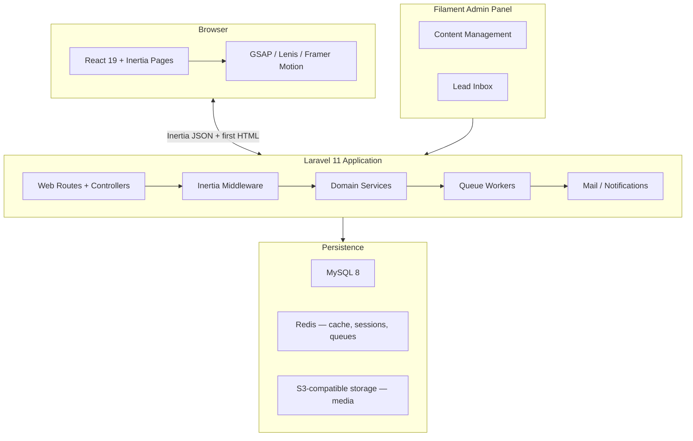
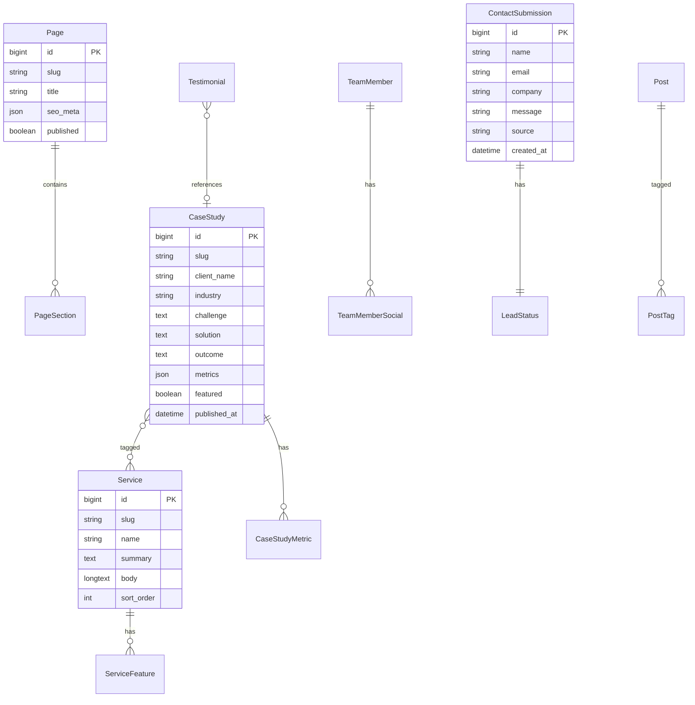

# FlipSwitch Website — Technical Architecture

> **Status:** Draft v1.1  
> **Brand reference:** [Brand Identity Doc.md](./Brand%20Identity%20Doc.md)  
> **Visual design:** To be defined in `design.md` (after design assets are provided) — not covered here.  
> **Goal:** Marketing site with smooth motion, Laravel backend, and room to grow into CMS, lead capture, and case-study publishing.

---

## 1. Executive Summary

FlipSwitch needs a website that communicates **research-driven AI engineering**, **technical credibility**, and measurable proof — backed by a maintainable CMS and lead pipeline.

This architecture uses:

| Layer | Choice | Why |
|-------|--------|-----|
| **Backend** | Laravel 11 (PHP 8.3+) | Mature ecosystem, fast admin tooling, queues, mail, auth |
| **Frontend** | React 19 + TypeScript + Inertia.js v2 | SPA-like UX without a separate API; excellent animation ecosystem |
| **Animation** | GSAP 3, Lenis, Framer Motion | Industry-standard scroll choreography + component motion |
| **Admin** | Filament v3 | Modern Laravel admin for content without building CMS from scratch |
| **Build** | Vite 6 | Fast HMR, code-splitting, SSR-ready if needed later |

The site is a **monolith with a rich client layer** — one deployable Laravel app serving both public pages and an admin panel, with React handling the public UI via Inertia.

**UI presentation** (colors, typography, spacing, components) will be specified separately in `design.md` once element mockups/images are available.

---

## 2. Architecture Principles

These constraints drive technical decisions (not visual design):

| Requirement | Technical expression |
|-------------|------------------------|
| Proof & credibility | Case studies, testimonials, measurable outcomes — CMS-backed |
| Lead generation | Contact / discovery-call forms with server validation & CRM hooks |
| Intentional motion | Scroll-driven reveals via GSAP; page transitions via Framer Motion |
| Content autonomy | Editors publish services, work, and team via Filament without deploys |
| Accessibility | Semantic HTML, ARIA where needed, `prefers-reduced-motion` respected |

**Motion rule:** Animation behavior is defined in this document; visual treatment of components is defined in `design.md`.

---

## 3. High-Level System Architecture



### Request flow (public page)

1. User visits `/services/ai-consulting`
2. Laravel route resolves → controller loads CMS content from DB
3. Inertia returns `Services/Show` page props as JSON embedded in initial HTML (SEO-friendly with SSR option)
4. React hydrates; GSAP ScrollTrigger initializes section reveals
5. Form submissions POST to Laravel → validation → queue → email/CRM webhook

---

## 4. Technology Stack (Detailed)

### 4.1 Backend — Laravel 11

| Package / Feature | Purpose |
|-------------------|---------|
| **Inertia Laravel adapter** | Bridge controllers to React pages |
| **Filament v3** | Admin for pages, services, case studies, testimonials, team, settings |
| **Spatie Laravel Media Library** | Image/asset management with conversions |
| **Spatie Laravel Sluggable** | SEO-friendly URLs for case studies & blog |
| **Laravel Sanctum** | Optional API tokens (future headless/mobile) |
| **Laravel Horizon** | Queue monitoring (production) |
| **Laravel Pennant** | Feature flags for phased rollouts |
| **Ziggy** | Named Laravel routes in TypeScript |

**PHP conventions:**
- Controllers stay thin; business logic in `app/Services/` and `app/Actions/`
- Form requests for validation (`StoreContactRequest`, etc.)
- Policies for Filament resource authorization
- Events + listeners for lead capture side effects

### 4.2 Frontend — React + Inertia

| Package | Purpose |
|---------|---------|
| **React 19** | UI components |
| **TypeScript 5.x** | Type-safe props from Inertia |
| **@inertiajs/react** | Page routing without React Router |
| **@headlessui/react** | Accessible dialogs, menus, tabs (unstyled primitives) |
| **react-hook-form + zod** | Client-side form validation (mirrors Laravel rules) |

**Folder structure (frontend):**

```
resources/js/
├── app.tsx                 # Inertia bootstrap
├── ssr.tsx                 # Optional SSR entry
├── types/
│   ├── index.d.ts          # Shared TS types
│   └── inertia.d.ts        # Page prop types
├── Components/
│   ├── ui/                 # Primitives (wired to design.md later)
│   ├── layout/             # Header, Footer, PageTransition
│   ├── sections/           # Hero, ServicesGrid, CaseStudyCarousel
│   └── motion/             # Reveal, Parallax, TextSplit wrappers
├── Layouts/
│   ├── MarketingLayout.tsx
│   └── MinimalLayout.tsx   # Legal pages
├── Pages/
│   ├── Home.tsx
│   ├── About.tsx
│   ├── Services/
│   │   ├── Index.tsx
│   │   └── Show.tsx
│   ├── Work/
│   │   ├── Index.tsx       # Case studies listing
│   │   └── Show.tsx
│   ├── Insights/
│   │   ├── Index.tsx       # Blog / articles
│   │   └── Show.tsx
│   ├── Contact.tsx
│   └── Legal/
│       ├── Privacy.tsx
│       └── Terms.tsx
├── hooks/
│   ├── useScrollReveal.ts
│   ├── useLenis.ts
│   └── usePrefersReducedMotion.ts
└── lib/
    └── gsap.ts             # GSAP + plugin registration
```

Global styles and component appearance live in `design.md` / `resources/css/` — added when designs are finalized.

### 4.3 Animation Stack

| Library | Version | Role |
|---------|---------|------|
| **[GSAP](https://gsap.com/)** | 3.x | ScrollTrigger timelines, text splits, staggered reveals |
| **[Lenis](https://lenis.darkroom.engineering/)** | 1.x | Smooth scroll (pairs with ScrollTrigger via `scrollerProxy`) |
| **[Framer Motion](https://www.framer.com/motion/)** | 11.x | Page transitions, modals, layout animations |
| **SplitType** (or GSAP SplitText Club) | — | Headline character/word animation |
| **Lottie React** | — | Optional loops from design exports |
| **Three.js + @react-three/fiber** | — | *Optional* hero — abstract mesh / particle field (Phase 2) |

**Animation architecture:**

```typescript
// resources/js/lib/gsap.ts
import gsap from 'gsap';
import { ScrollTrigger } from 'gsap/ScrollTrigger';

gsap.registerPlugin(ScrollTrigger);

export { gsap, ScrollTrigger };
```

```typescript
// resources/js/hooks/useScrollReveal.ts
// Wrapper: respects prefers-reduced-motion, cleans up ScrollTriggers on unmount
```

**Accessibility:** All motion hooks check `prefers-reduced-motion: reduce` and skip or simplify animations. Lenis is disabled when reduced motion is preferred.

**Performance rules:**
- Animate only `transform` and `opacity` (GPU-friendly)
- Use `will-change` sparingly; remove after animation completes
- Lazy-load Lottie and Three.js chunks
- `ScrollTrigger.batch()` for long case-study lists

---

## 5. Site Map & Page Architecture

Aligned with brand offerings, proof, and touchpoints:

```
/                           Home — hero, value prop, services preview, proof, CTA
/about                      Story, values, team, vision
/services                   All offerings
/services/{slug}            AI Engineering Lab, Consulting, Custom Solutions, etc.
/work                       Case studies & success stories
/work/{slug}                Individual case study
/insights                   Articles / research notes (optional Phase 2)
/insights/{slug}            Article detail
/contact                    Discovery call / contact form
/legal/privacy
/legal/terms
```

**Home page sections (component map):**

| Section | Component | Motion (behavior only) |
|---------|-----------|------------------------|
| Hero | `HeroSection` | Split headline reveal, optional parallax |
| Social proof strip | `LogoMarquee` | Horizontal scroll (GSAP or CSS animation) |
| Problem → solution | `NarrativeSection` | Scroll-triggered fade-up stagger |
| Services | `ServicesGrid` | Staggered enter on scroll |
| Process | `DeliveryProcess` | Step timeline draw-on-scroll |
| Case studies | `FeaturedWork` | Horizontal scroll or carousel |
| Testimonials | `TestimonialStack` | Crossfade on scroll |
| CTA | `DiscoveryCallCTA` | Enter on scroll |

---

## 6. Backend Domain Model

### 6.1 Core entities



### 6.2 Key migrations (conceptual)

| Table | Notes |
|-------|-------|
| `pages` | CMS-managed static pages (About blocks) |
| `page_sections` | Flexible JSON `content` per section type |
| `services` | Five offering categories from brand doc |
| `case_studies` | Portfolio with metrics JSON `{ "efficiency_gain": "40%" }` |
| `testimonials` | Quote, author, role, optional case study FK |
| `team_members` | Founders & leadership for credibility |
| `posts` | Insights/blog (Phase 2) |
| `contact_submissions` | Lead capture with spam protection |
| `site_settings` | Key-value: tagline, social links, analytics IDs |

### 6.3 Filament admin resources

| Resource | Capabilities |
|----------|--------------|
| **Services** | CRUD, reorder, publish draft |
| **Case Studies** | Rich editor, media gallery, featured toggle |
| **Testimonials** | Approve/publish workflow |
| **Team** | Photo upload, bio, social links |
| **Contact Submissions** | Read-only inbox, export CSV, mark contacted |
| **Posts** | Markdown/WYSIWYG, scheduled publish |
| **Site Settings** | Global SEO, navigation, footer links |

---

## 7. API & Integration Points

### 7.1 Internal (Inertia props)

Controllers return typed page props — no public REST API required for v1.

```php
// app/Http/Controllers/WorkController.php
return Inertia::render('Work/Show', [
    'caseStudy' => CaseStudyResource::make($caseStudy),
    'related'   => CaseStudyResource::collection($related),
]);
```

### 7.2 External integrations (Phase 1–2)

| Integration | Trigger | Purpose |
|-------------|---------|---------|
| **Email (SMTP / Resend / Postmark)** | Contact form queued job | Notify sales team |
| **Google Analytics 4** | Page views | Traffic & conversion tracking |
| **Plausible / Fathom** | Alternative | Privacy-friendly analytics |
| **Cal.com / Calendly embed** | Contact page | Discovery call booking |
| **HubSpot / Pipedrive webhook** | New lead | CRM pipeline (Phase 2) |
| **Cloudflare Turnstile** | Contact form | Bot protection |
| **Instagram / YouTube oEmbed** | Home optional | Social proof embeds |

---

## 8. SEO, Performance & Accessibility

| Concern | Approach |
|---------|----------|
| **SEO** | Inertia SSR (optional), semantic HTML, `<Head>` per page, JSON-LD `Organization` + `ProfessionalService` schema |
| **Meta** | Filament-managed per page/post via `seo_meta` JSON |
| **Sitemap** | `spatie/laravel-sitemap` — auto-generate on content publish |
| **Performance** | Target Lighthouse 90+; Vite chunk splitting; WebP/AVIF via Media Library |
| **Images** | `loading="lazy"`, explicit `width`/`height`, responsive `srcset` |
| **A11y** | WCAG 2.1 AA — keyboard navigation, skip link, aria labels, reduced motion |
| **i18n** | English-only v1; Laravel localization structure reserved for future |

---

## 9. Security

| Area | Measure |
|------|---------|
| **Forms** | CSRF (Inertia default), rate limiting (`throttle:5,1`), Turnstile |
| **Admin** | Filament auth, 2FA (Filament plugin), IP allowlist optional |
| **Headers** | CSP, HSTS, X-Frame-Options via middleware |
| **Input** | Form requests, HTML purification for rich content |
| **Secrets** | `.env` only; never commit; Laravel encrypted env in production |
| **Dependencies** | `composer audit`, `npm audit` in CI |

---

## 10. DevOps & Environments

### 10.1 Environments

| Env | Purpose |
|-----|---------|
| **local** | Docker Sail or Laravel Herd |
| **staging** | Content preview + QA |
| **production** | Public site |

### 10.2 Recommended hosting

| Component | Option A (simple) | Option B (scalable) |
|-----------|-------------------|---------------------|
| App | Laravel Forge + DigitalOcean / Hetzner VPS | AWS ECS / Laravel Vapor |
| DB | Managed MySQL | RDS |
| Redis | Upstash / managed Redis | ElastiCache |
| Media | DO Spaces / Cloudflare R2 | S3 + CloudFront |
| CDN | Cloudflare | Cloudflare |

### 10.3 CI/CD (GitHub Actions)

```yaml
# Pipeline stages
1. lint     → pint, eslint, tsc --noEmit
2. test     → phpunit, pest (feature tests for forms & routes)
3. build    → npm run build
4. deploy   → Forge webhook / Vapor deploy on main branch
```

### 10.4 Local development setup

```bash
# Prerequisites: PHP 8.3+, Composer, Node 22+, MySQL, Redis

composer create-project laravel/laravel flipswitch-website
cd flipswitch-website

composer require inertiajs/inertia-laravel filament/filament spatie/laravel-medialibrary
npm install @inertiajs/react react react-dom typescript
npm install gsap lenis framer-motion

php artisan filament:install
php artisan migrate
npm run dev
php artisan serve
```

---

## 11. Project Repository Structure

```
flipswitch-website/
├── app/
│   ├── Actions/              # Single-purpose action classes
│   ├── Filament/             # Admin resources
│   ├── Http/
│   │   ├── Controllers/
│   │   └── Requests/
│   ├── Models/
│   └── Services/
├── database/
│   ├── migrations/
│   └── seeders/              # Demo case studies, services
├── resources/
│   ├── js/                   # React + Inertia (see §4.2)
│   ├── css/                  # Added per design.md
│   └── views/
│       └── app.blade.php     # Inertia root template
├── routes/
│   ├── web.php
│   └── filament.php
├── tests/
│   ├── Feature/              # Contact form, page routes
│   └── Browser/              # Optional: Pest + Laravel Dusk
├── public/
├── architecture.md
├── design.md                 # Created when design assets are ready
├── Brand Identity Doc.md
├── composer.json
├── package.json
├── vite.config.ts
├── tsconfig.json
└── .env.example
```

---

## 12. Implementation Phases

### Phase 1 — Foundation (Week 1–2)

- [ ] Laravel 11 + Inertia + React scaffold
- [ ] Marketing layout shell (header, footer, mobile nav) — unstyled placeholders
- [ ] Home page section components with placeholder content
- [ ] Lenis + GSAP scroll reveal utilities
- [ ] Contact form → DB + email notification
- [ ] Filament admin (basic settings)

### Phase 2 — Content & Motion (Week 3–4)

- [ ] `design.md` finalized from provided element images
- [ ] Apply visual design to all marketing pages
- [ ] Services CRUD + dynamic `/services/{slug}`
- [ ] Case studies CRUD + `/work` listing & detail
- [ ] Testimonials section (CMS-driven)
- [ ] Page transitions (Framer Motion)
- [ ] SEO meta + sitemap
- [ ] About + team page

### Phase 3 — Polish & Launch (Week 5)

- [ ] Performance audit (Lighthouse, bundle analysis)
- [ ] Accessibility audit
- [ ] Analytics + Turnstile
- [ ] Staging → production deploy
- [ ] 301 redirects if migrating from old domain

### Phase 4 — Growth (Post-launch)

- [ ] Insights/blog with RSS
- [ ] CRM webhook integration
- [ ] Optional Three.js hero (if specified in design.md)
- [ ] A/B testing via Pennant
- [ ] Inertia SSR for heavy SEO pages

---

## 13. Key Dependencies (Pinned Targets)

### Composer (PHP)

```json
{
  "require": {
    "php": "^8.3",
    "laravel/framework": "^11.0",
    "inertiajs/inertia-laravel": "^2.0",
    "filament/filament": "^3.0",
    "spatie/laravel-medialibrary": "^11.0",
    "spatie/laravel-sitemap": "^7.0",
    "tightenco/ziggy": "^2.0"
  }
}
```

### NPM (JavaScript)

```json
{
  "dependencies": {
    "@inertiajs/react": "^2.0",
    "react": "^19.0",
    "react-dom": "^19.0",
    "gsap": "^3.12",
    "lenis": "^1.1",
    "framer-motion": "^11.0",
    "@headlessui/react": "^2.0",
    "react-hook-form": "^7.0",
    "zod": "^3.23"
  },
  "devDependencies": {
    "typescript": "^5.6",
    "vite": "^6.0",
    "@vitejs/plugin-react": "^4.0"
  }
}
```

> CSS framework, icons, and font packages will be chosen in `design.md` after mockups are reviewed.

---

## 14. Open Decisions

| Decision | Options | Notes |
|----------|---------|-------|
| Blog | On-site vs Substack embed | On-site for SEO; link Substack in footer |
| Booking | Embedded Cal.com vs form-only | Cal.com embed on Contact page |
| SSR | Client-only vs Inertia SSR | Client-only Phase 1; add SSR if SEO gaps appear |
| Hero treatment | Static, Lottie, Three.js | Decided in design.md with assets |
| CSS approach | Tailwind, CSS modules, etc. | Decided in design.md |

---

## 15. Success Criteria

The architecture is successful when:

1. **Credibility** — Case studies and testimonials are easy to publish without developer involvement
2. **Lead capture** — Contact submissions are reliable, spam-resistant, and routed to the team within minutes
3. **Performance** — LCP < 2.5s, CLS < 0.1 on Home (desktop & mobile)
4. **Maintainability** — Content editors use Filament; developers extend React sections cleanly
5. **Scalability** — Same codebase supports blog, CRM hooks, and optional API without re-architecture
6. **Design alignment** — Implementation matches `design.md` once visual specs are provided

---

*Next step: scaffold the Laravel + Inertia + React project (Phase 1), then create `design.md` when element images are ready.*
